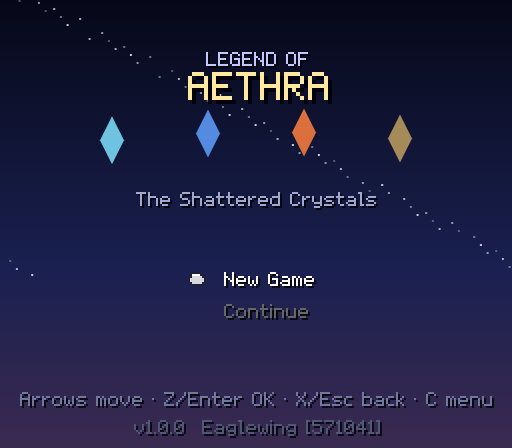
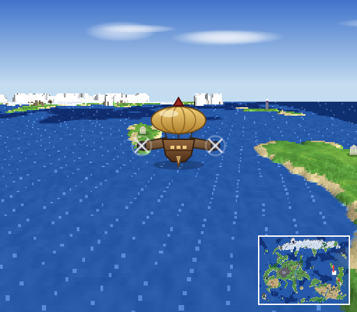
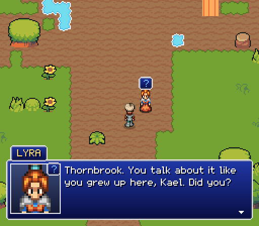
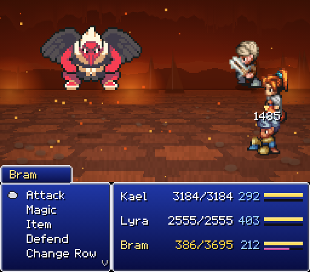
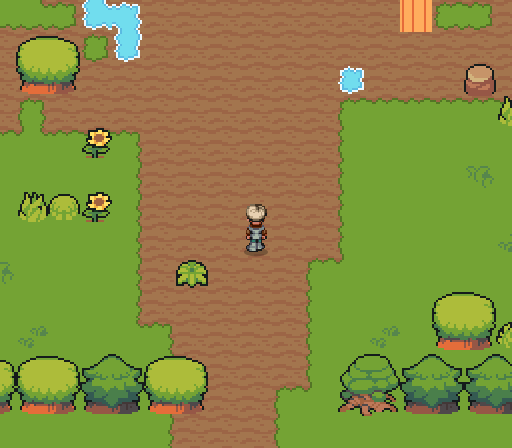
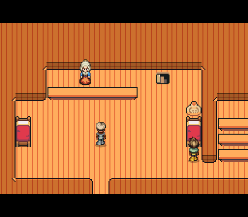

# 💎 Legend of Aethra

A 16-bit style role-playing game for [Torn](https://www.torn.com), in the spirit of the classic active-time-battle RPGs.
It plays inside the **Torn Arcade** phone (Legends folder) or in its own window from the Tampermonkey menu.

**Install:** [Legend-of-Aethra.user.js](https://github.com/Eaglewing91/Legend-of-Aethra/raw/main/build/Legend-of-Aethra.user.js)
(about 2.2 MB). Optional music: [Legend-of-Aethra-Soundtrack.user.js](https://github.com/Eaglewing91/Legend-of-Aethra/raw/main/build/Legend-of-Aethra-Soundtrack.user.js) (the full original score, 45 tracks, about 9 MB). Without it you still hear the sound effects, but no background music.
In the Torn Arcade phone, the game and its Soundtrack sit side by side in the **Legends** folder.

> ⚠️ **Large scripts.** The game (about 2.2 MB) and the Soundtrack (about 9 MB) are much bigger than a usual userscript.
> They can take a moment to install and to load, and **some mobile browsers and userscript managers may not be able to
> install or run scripts this size**. If the Soundtrack won't install or slows your phone down, leave it out: the game
> still plays, with sound effects but no music. A PC or laptop is the most reliable way to play.

| | |
|---|---|
|  |  |
|  |  |
|  |  |

## The game
A newly sworn Warden of the Vanguard Academy takes his first contract: get the rebel cell Undercurrent into Aurex
Dynamics' Reactor 4, and out again. The reactor goes up far bigger than planned, and the Warden falls into a story about
stolen memories, four Crystals that hold up the sky, and the woman who wants all four.

- **Five acts**, about 40 hours: Halcyon, Meridia, Solmara, Nordheim and the Broken Sky. The story follows eight
  playable characters, with night talks at inns, a rival who changes sides, and epilogues for everyone who joined you.
- **300 maps**: towns that each have their own shape and streets, 157 interiors (many with upstairs rooms and cellars)
  and big multi-floor dungeons: Reactor 4, Aurex Tower, Mistwood, the Wind Shrine, the Coral Sanctum, Orin's Tower,
  Mount Cinder, the Deeproot, the Sky Citadel and more.
- **Active-time battles** with Wait or Active mode, front and back rows, elements, status effects, back attacks,
  stealing, Mimic, Surge Arts and Echo summons. 154 monsters and 52 bosses, with a Bestiary.
- **Prisms**: slot them in weapons and armour for spells, commands and support; link them in pairs; they level up.
- **An open 3D world map** you can cross on foot, by talonbird, skimmer, boat, submersible and the airship Skylark. Some
  places can only be reached by sea or by air, and the sky changes with the time of day.
- **Secrets and side content**: hidden places and their guardians, a ghost ship, Needle Atoll (a dangerous little island
  where the bravest go to level up), legendary Prisms, the Arcana card game (66 cards), talonbird races and breeding,
  slots, a shooting gallery, snowboarding, a submarine duel, the Battle Square, bounties, side quests, Echo trials,
  roaming Weapons, super-bosses, the 50-floor Abyssal Spire and New Game+.
- **An original soundtrack** (optional script): 45 tracks in the style of the classic Final Fantasy scores, with a theme
  for every town and its own music for the big battles.
- Three save files plus a resume point when you close it.

**Controls:** arrows/WASD move · Z, Enter or Space OK · X or Esc back · C menu · Shift run · M world map ·
hold Q+E to flee a battle. On a touch screen, the touch pad has a D-pad, OK, back, MENU, RUN and MAP, plus a FLEE button
(hold it) that appears in battles you can run from.

## Rules and privacy
The game never reads, clicks or changes Torn's page, makes no network requests, uses no API key and no websockets.
It reads keys only while its window is open. Saves stay in Tampermonkey storage on your device. It talks to Torn Arcade
through page events only (`aethra:ping`, `aethra:here`, `aethra:open`, `aethra:close`, `aethra:closed`, `aethra:mute`,
`aethra:volume`); the Soundtrack script answers `aethra-music:request` with `aethra-music`.

| Data Storage | Data Sharing | Purpose of Use | Key Storage & Sharing | Key Access Level |
|---|---|---|---|---|
| Only locally (save files in Tampermonkey storage) | Nobody | Public amusement | Not stored / Not shared (no key used) | None (no API key needed) |

## Credits
By Eaglewing [571041]. Art and sound effects: "Ninja Adventure" by Pixel-boy and AAA (CC0), and "Zelda-like tilesets and sprites" by ArMM1998 (CC0). The side-on boss sprites were turned from the Ninja Adventure originals (tools/sides). Music: an original score in the style of the classic Final Fantasy soundtracks, composed and synthesised for this game (tools/music). Characters and townspeople:
"Mana Seed" by Seliel the Shaper, used under licence with permission (not CC0; don't extract or reuse it).
All rights reserved, for use on Torn only: see [LICENCE](LICENCE).
